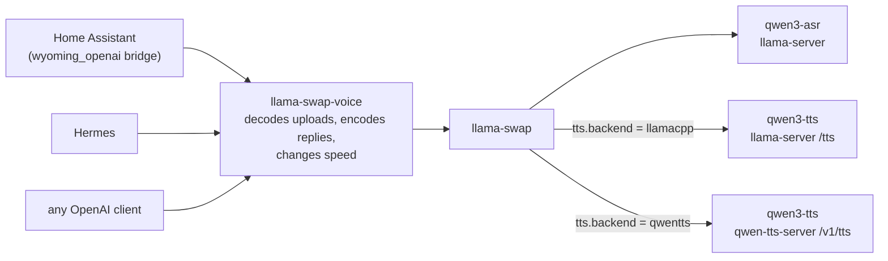
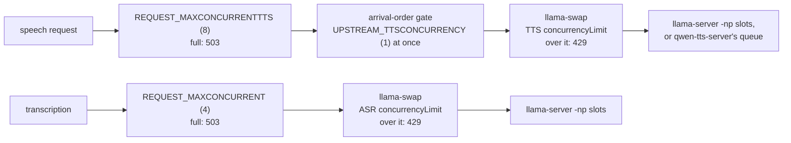

# llama-swap-voice

Local speech-to-text and text-to-speech for Home Assistant Voice, Hermes and
any OpenAI-compatible client, on the
[llama-swap](https://github.com/mostlygeek/llama-swap) you already run.

Clients talk to it as they would to OpenAI's audio API. Behind it two small
Qwen3 models do the work on your own hardware: one listens, and one speaks in
a voice cloned from a short clip you provide. The repository is a Nix flake:
its NixOS module runs the service, adds both models to your llama-swap and
wires the two together.

## Quick start

You need NixOS with flakes enabled and a voice clip. Paste this into
`flake.nix` beside the `configuration.nix` that `nixos-generate-config`
wrote, or add the input and the module to your own flake:

```nix
{
  inputs = {
    nixpkgs.url = "github:NixOS/nixpkgs/nixos-unstable";
    llama-swap-voice.url = "github:mniehe/llama-swap-voice";
  };

  outputs = {
    nixpkgs,
    llama-swap-voice,
    ...
  }: {
    nixosConfigurations.voicebox = nixpkgs.lib.nixosSystem {
      system = "x86_64-linux";
      modules = [
        ./configuration.nix
        llama-swap-voice.nixosModules.default
        {
          services.llama-swap.enable = true;

          services.llama-swap-voice = {
            enable = true;
            defaultVoice = "sample";
            voices.sample.clip = "/srv/voices/sample.wav";
          };
        }
      ];
    };
  };
}
```

Fetch a clip to try it with, the sample from Qwen's own documentation, then
switch:

```sh
sudo mkdir -p /srv/voices
sudo curl -L -o /srv/voices/sample.wav \
  https://qianwen-res.oss-cn-beijing.aliyuncs.com/Qwen3-TTS-Repo/clone.wav
sudo nixos-rebuild switch --flake .#voicebox
```

The first build downloads the pinned Qwen3 ASR and TTS GGUFs, about 4.8 GB.
llama-swap loads both at start. Then:

```sh
curl -s localhost:8920/v1/audio/speech \
  -H 'Content-Type: application/json' \
  -d '{"input": "The kitchen lights are off.", "response_format": "mp3"}' \
  -o hello.mp3

curl -s localhost:8920/v1/audio/transcriptions -F file=@hello.mp3
# {"text":"The kitchen lights are off."}
```

llama.cpp runs on the CPU by default. For an NVIDIA GPU, set
`services.llama-swap-voice.llamaCpp.backend = "cuda";` (`vulkan` and `rocm`
work too). The module needs `services.llama-swap.enable = true` and refuses
`services.llama-swap.settings.apiKeys`, because the service cannot send a key.
When llama-swap runs on another host, set `llamaSwap.enable = false` and
`upstreamURL` instead.

## How it works



1. A client sends audio to `/v1/audio/transcriptions` or text to
   `/v1/audio/speech`.
2. llama-swap-voice turns that request into the one the model server expects.
   It decodes uploads to 16 kHz mono WAV in-process, and for speech it
   attaches the voice's clip (`llamacpp`) or names the voice (`qwentts`).
3. llama-swap starts the model if it is not running and passes the request on.
4. The reply is encoded into the format the client asked for as it arrives,
   so playback starts before the whole sentence is ready.

The service runs no external programs: no ffmpeg, no sox.

## Voices

A voice is a recording of the speaker, named after its file. Declare each one
in the module:

```nix
services.llama-swap-voice.voices.narrator = {
  clip = "/srv/voices/narrator.wav";
  transcript = "The exact words spoken in the clip.";
};
```

The module links each clip into `<stateDir>/voices` as `<name>.<extension>`.
Every `.wav` or `.mp3` in that directory is a voice, so a clip copied there
by hand counts too, and a symlink is an alias: `alloy.mp3 -> sample.wav`
lets a client that asks for OpenAI's `alloy` hear `sample`. Requests that name
no voice get `defaultVoice`. The service reads voices at startup; restart it
after adding one. A clip over 10 MiB is a startup error.

Clips stay where they are and never enter the Nix store. Keep them outside
`/home`, which neither the service nor llama-swap can read. The voices
directory is trusted operator configuration: symlinks in it are followed
wherever they point. Only use recordings you have the right to clone.

### Two TTS backends

`tts.backend` picks the server that speaks:

| | `llamacpp` (default) | `qwentts` |
|---|---|---|
| Server | llama.cpp's `llama-server`, `/tts` | `qwen-tts-server` from `python/`, which runs [faster-qwen3-tts](https://pypi.org/project/faster-qwen3-tts/), `/v1/tts` |
| Cloning | From a speaker embedding of the clip only | In context from the clip plus its exact transcript, which keeps accents |
| Request | Multipart form with the text, `TTS_LANG` and the clip | JSON with the text and the voice's name; no clip |
| A voice needs | A `.wav` or `.mp3` clip | A `.wav` clip that the module's group can read, and its exact `transcript`. A `null` transcript falls back to embedding-only cloning, which keeps the voice but loses its accent. `instruct` and the sampling settings are optional |
| Hardware | CPU, or a GPU through `llamaCpp.backend` | An NVIDIA GPU on x86_64 Linux |
| Built | llama.cpp from nixpkgs and the pinned GGUFs | The CUDA Python environment (several GB of wheels) and the Qwen3-TTS weights (about 4.5 GB) |

Keep `llamacpp` for a CPU or a non-NVIDIA GPU, or when the voice's accent
does not matter. Pick `qwentts` on an NVIDIA GPU to keep accents:

```nix
services.llama-swap-voice.tts.backend = "qwentts";
```

Both are built on demand: the build of a system that selects the backend
fetches what it needs. `nix flake check` builds neither the CUDA environment
nor the weights; it runs the Python server's tests against a fake engine and
checks the weights pin at evaluation.

Under `qwentts` the service sends only the voice's name, so each voice needs
a clip on both sides; the module writes the server's configuration from the
same registry. Transcripts and instructs land in the world-readable Nix
store, so they are not secret.

### Preparing a voice

llama-swap-voice and `qwen-tts-server` pass a clip on as it is, so prepare
each clip once:

1. Cut about 30 seconds of clean speech, starting and ending on a sentence
   boundary.
2. Normalise it to -22 LUFS integrated and -1.5 dBTP true peak with ffmpeg's
   `loudnorm` in two passes, writing mono 24 kHz 16-bit WAV. The first pass
   measures:

   ```sh
   ffmpeg -hide_banner -nostats -i source.wav \
     -af loudnorm=I=-22:TP=-1.5:LRA=11:print_format=json -f null -
   ```

   The second feeds the measured `input_i`, `input_tp`, `input_lra` and
   `input_thresh` back as `measured_I`, `measured_TP`, `measured_LRA` and
   `measured_thresh`, and `target_offset` as `offset`, so a single gain is
   applied:

   ```sh
   ffmpeg -hide_banner -i source.wav \
     -af loudnorm=I=-22:TP=-1.5:LRA=11:measured_I=$input_i:measured_TP=$input_tp:measured_LRA=$input_lra:measured_thresh=$input_thresh:offset=$target_offset:linear=true:print_format=summary \
     -ac 1 -ar 24000 -sample_fmt s16 robbie.wav
   ```

3. Check that the gain really was one gain. `loudnorm` drops to dynamic mode
   silently when the gain would push the true peak over the ceiling, and
   dynamic mode reshapes the voice. The check is a scalar-gain null test:
   measure the integrated loudness of `robbie.wav` as in the first pass, scale
   the source by the difference and subtract it from the clip. What remains
   should be tens of dB below the clip's own level; a residual within a few dB
   of it means the gain varied.

   ```sh
   # output_i: input_i printed by the first-pass command run on robbie.wav
   gain=$(echo "$output_i - ($input_i)" | bc)
   ffmpeg -hide_banner -i source.wav -af volume=${gain}dB -ac 1 -ar 24000 -sample_fmt s16 scaled.wav
   ffmpeg -hide_banner -nostats -i robbie.wav -i scaled.wav -filter_complex \
     '[0][1]amerge=inputs=2,pan=mono|c0=c0-c1,astats=measure_perchannel=none:measure_overall=RMS_level' -f null -
   ffmpeg -hide_banner -nostats -i robbie.wav \
     -af astats=measure_perchannel=none:measure_overall=RMS_level -f null -
   ```

   If the clip went dynamic, lower its peaks or choose a quieter target, and
   normalise again.
4. Under `qwentts`, write the exact transcript of the clip, word for word,
   into the voice's `transcript`. The server cannot tell a wrong transcript
   from a right one: a placeholder passes validation and ruins the voice.

ffmpeg is needed only for this preparation; nothing here runs it.

## Connect your apps

**Hermes** speaks the OpenAI audio API (`~/.hermes/config.yaml`):

```yaml
stt:
  provider: openai
  openai:
    base_url: http://localhost:8920/v1
    api_key: not-needed
    model: qwen3-asr
tts:
  provider: openai
  openai:
    base_url: http://localhost:8920/v1
    api_key: not-needed
    model: qwen3-tts
    voice: sample
```

The key is a placeholder: Hermes wants one, and llama-swap-voice ignores it.

**Home Assistant** speaks Wyoming, and llama-swap-voice has no Wyoming
listener. Run the [wyoming_openai](https://github.com/roryeckel/wyoming_openai)
bridge in front of it:

```sh
STT_BACKEND=OPENAI  STT_OPENAI_URL=http://localhost:8920/v1  STT_MODELS=qwen3-asr
TTS_BACKEND=OPENAI  TTS_OPENAI_URL=http://localhost:8920/v1  TTS_MODELS=qwen3-tts
TTS_VOICES=sample
```

Then add a Wyoming integration in Home Assistant that points at the bridge.

## Configuration

### Module options

Every option sits under `services.llama-swap-voice`. A name such as
`shutdown.{grace,total,hard}` stands for one option per name in the braces.

**The service**

| Option | Default | What it does |
|---|---|---|
| `enable` | `false` | Run the service as a systemd unit |
| `package` | this flake's package | The build to run |
| `user`, `group` | `"llama-swap-voice"` | Account the service runs as. The module creates them only under the default name; a custom user or group must already exist. Under `qwentts` llama-swap's user joins `group` and gains all its access, so do not pick a group other services share |
| `stateDir` | `"/var/lib/llama-swap-voice"` | Directory the module owns; the service reads voices from `<stateDir>/voices`. An absolute path without a trailing slash or `%`. It must belong to this module alone, because tmpfiles sets its owner and mode |
| `defaultVoice` | `null`, must be set | `VOICES_DEFAULT`; one of `voiceNames` |
| `host`, `port` | `"127.0.0.1"`, `8920` | `HOST`, `PORT` |
| `upstreamURL` | llama-swap's address, or `"http://127.0.0.1:8080"` when `llamaSwap.enable` is false | `UPSTREAM_URL`. A wildcard listen address (`""`, `0.0.0.0`, `[::]`) becomes loopback, and `services.llama-swap.tls.enable` selects `https`; the certificate must then cover the derived host (`localhost` by default) or you set this by hand. Evaluation checks only for `http://` or `https://`, a host and no whitespace; the service parses the URL fully at startup |
| `ipAddressAllow` | `[]` | Addresses besides loopback the service may exchange packets with, in systemd's `IPAddressAllow=` syntax |
| `tts.backend` | `"llamacpp"` | `UPSTREAM_TTSBACKEND`: `llamacpp` or `qwentts` |
| `tts.maxInputChars` | `null` | `TTS_MAXINPUTCHARS` |
| `upstream.ttsConcurrency` | `1` | `UPSTREAM_TTSCONCURRENCY`; see [Concurrency](#concurrency) |
| `request.timeout` | `null` | `REQUEST_TIMEOUT`, a positive Go duration |
| `request.maxConcurrent`, `request.maxConcurrentTTS` | `null` | `REQUEST_MAXCONCURRENT`, `REQUEST_MAXCONCURRENTTTS` |
| `shutdown.{grace,total,hard}` | `null` | `SHUTDOWN_GRACE` (a Go duration), `SHUTDOWN_TOTAL` and `SHUTDOWN_HARD` (positive Go durations) |
| `extraEnvironment` | `{}` | Extra variables by full name; they win over the generated ones. See below |

A limit left `null` leaves its variable unset, so the service's own default
applies. Durations use Go's syntax, such as `1m30s`, without a leading `+` or
`-`; evaluation reads them exactly as the service does and refuses any above
Go's maximum of about 292 years.

The module reads six variables itself after `extraEnvironment` is merged:
`SHUTDOWN_GRACE`, `SHUTDOWN_TOTAL` and `SHUTDOWN_HARD` set `TimeoutStopSec`,
and `TTS_MAXINPUTCHARS`, `UPSTREAM_TTSCONCURRENCY` and `REQUEST_MAXCONCURRENT`
feed the llama-swap entries. A value set through `extraEnvironment` counts
instead of the option it overrides, and evaluation fails, naming the
variable, if it is not a value the option would accept: a Go duration, or a
positive decimal integer without a sign or leading zero. `TimeoutStopSec` is
the sum of the shutdown durations you set plus 30 seconds for those you leave
unset, and at least 90 seconds.

**Voices**

| Option | Default | What it does |
|---|---|---|
| `voices` | `{}` | The voice registry, by name. A name starts with a letter, digit or `_` and holds only letters, digits, `.`, `_` and `-` |
| `voices.<name>.clip` | must be set | Absolute path to the recording, as a string so it stays out of the store. `.wav` or `.mp3`, and `.wav` under `qwentts` |
| `voices.<name>.transcript` | `null` | What the clip says, for `qwentts`. Null selects embedding-only cloning, which keeps the voice but not its accent |
| `voices.<name>.instruct` | `null` | Style instruction, for `qwentts`; needs a transcript |
| `voices.<name>.{temperature,topK,topP,repetitionPenalty}` | `0.7`, `50`, `1.0`, `1.05` | Sampling settings, for `qwentts` |
| `voiceNames` | the declared names | Read-only: the declared voice names, sorted, since Nix attribute sets keep no order |

The `llamacpp` backend uses only the clip and ignores the rest. Evaluation
fails, naming the option, when `defaultVoice` is missing or undeclared, a clip
path is relative or has another extension, or a `qwentts` voice has an
`instruct` without a transcript or a transcript of only whitespace, as
Python's `str.strip` counts it.

If a declared link in `<stateDir>/voices` points somewhere other than its
clip, for example after you change the clip's path, the service refuses to
start until you delete the link and run `systemd-tmpfiles --create`. The
module never removes links: after you delete a voice, or change a clip's
extension (case included), delete the old link by hand; otherwise the service
refuses to start with `voice "<name>" is provided by both`.

**llama-swap and the llama.cpp entries**

| Option | Default | What it does |
|---|---|---|
| `llamaSwap.enable` | `true` | Add the entries to `services.llama-swap.settings` and derive `upstreamURL`. Off, the module leaves `services.llama-swap` untouched |
| `llamaSwap.group.enable` | `true` | Put both entries in a group that keeps them loaded; see [When the models unload](#when-the-models-unload) |
| `llamaSwap.group.name` | `"voice"` | The group's name |
| `llamaSwap.group.location` | `"legacy"` | `legacy` writes top-level `groups`; `routing` writes `routing.router.settings.groups`. llama-swap refuses a configuration with both layouts, so match yours |
| `llamaCpp.backend` | `"cpu"` | `cpu`, `cuda`, `vulkan` or `rocm`. Picks the default package and, for `cuda`, relaxes llama-swap's unit |
| `llamaCpp.package` | `pkgs.llama-cpp` built for `llamaCpp.backend` alone | The llama.cpp providing `llama-server`, 0.8.0 or newer. The default sets every backend flag, so `nixpkgs.config.cudaSupport` cannot add CUDA to a `cpu` build. A package you set must match `llamaCpp.backend`. The check reads the package's version, so a version that is a build number passes unchecked |
| `models.{asr,tts}.name` | `"qwen3-asr"`, `"qwen3-tts"` | Entry names, not empty and not equal. `models.tts` is used only under `llamacpp` |
| `models.{asr,tts}.artifacts.{model,mmproj}` | the pinned GGUF | The model and its multimodal projector, each with `url`, `hash` and `path` |
| `models.{asr,tts}.artifacts.{model,mmproj}.{url,hash}` | pinned Hugging Face revision and SRI hash | Where the file comes from |
| `models.{asr,tts}.artifacts.{model,mmproj}.path` | `pkgs.fetchurl { inherit url hash; }` | The file on disk. Set it to a local file, as a string, to skip the download; a Nix path literal would copy the file into the store |
| `models.{asr,tts}.device` | `null` | `--device`, such as `CUDA0`; null leaves it out, which a CPU build needs |
| `models.{asr,tts}.{gpuLayers,contextSize,parallel}` | `99`, `4096`, `1` | `-ngl`, `-c`, `-np` |
| `models.{asr,tts}.concurrencyLimit` | ASR: the service's transcription limit (4 unless changed); TTS: `5` | llama-swap's `concurrencyLimit`. llama-swap answers 429 beyond it; within it, `llama-server` queues requests beyond its `parallel` slots |
| `models.{asr,tts}.ttl` | `0` | Seconds idle before llama-swap unloads the entry; 0 never unloads it for idleness. See [When the models unload](#when-the-models-unload) |
| `models.{asr,tts}.preload` | `true` | Load the entry when llama-swap starts |
| `models.{asr,tts}.extraArgs` | `[]` | Appended to the `llama-server` command |

The commands are
`llama-server --port ${PORT} -m <model> --mmproj <mmproj> [--device <device>] -ngl 99 -c 4096 -np 1 --flash-attn on --no-webui`,
with `--temp 0` before `--flash-attn` for the ASR entry. Both check `/health`.

**The `qwentts` entry**

| Option | Default | What it does |
|---|---|---|
| `tts.qwentts.package` | this flake's `qwen-tts-server` | The server; the flake builds it for x86_64 Linux only |
| `tts.qwentts.model` | this flake's `qwen3-tts-model` | The weights directory. A local copy works; give it as a string, because a Nix path literal copies it into the store |
| `tts.qwentts.modelName` | `"qwen3-tts"` | Entry name, not empty |
| `tts.qwentts.{language,chunkSize,queueSize,queueWaitSeconds,maxSegmentChars,maxNewTokens}` | `"English"`, `12`, `8`, `60`, `400`, `600` | The server's `language`, `chunk_size`, `queue_size`, `queue_wait_seconds`, `max_segment_chars` and `max_new_tokens`; see [Config](#config) |
| `tts.qwentts.concurrencyLimit` | `queueSize` | llama-swap's `concurrencyLimit`; llama-swap answers 429 beyond it |
| `tts.qwentts.{ttl,preload}` | `0`, `true` | As for the llama.cpp entries |
| `tts.qwentts.cudaDevice` | `"0"` | `CUDA_VISIBLE_DEVICES`, in PCI bus order |
| `tts.qwentts.extraArgs` | `[]` | Appended to the `qwen-tts-server` command |

The entry runs `qwen-tts-server --port ${PORT} --config <generated JSON>` and
checks `/health`. The generated configuration takes `max_input_chars` from the
effective `TTS_MAXINPUTCHARS`, so the server and the service refuse the same
inputs, and each voice's `clip` is its link in `<stateDir>/voices`.
`nix flake check` loads a generated file with the server's own parser.

### What the module adds to llama-swap

With `llamaSwap.enable` on, the module merges into
`services.llama-swap.settings`, beside your own models:

- the ASR entry, `models.asr.name`, running `llama-server` on the pinned
  Qwen3-ASR-1.7B Q8_0 GGUF and its projector;
- exactly one TTS entry: under `llamacpp`, `models.tts.name` running
  `llama-server` on the pinned Qwen3-TTS-12Hz-1.7B-Base Q8_0 GGUFs; under
  `qwentts`, `tts.qwentts.modelName` running `qwen-tts-server`;
- the preloaded entries in `hooks.on_startup.preload`, beside yours;
- with `llamaSwap.group.enable`, the group that holds both entries.

It sets no top-level llama-swap value such as `healthCheckTimeout`, and it
sets `UPSTREAM_TTSMODEL` and `UPSTREAM_ASRMODEL` to the two entries' names.

#### When the models unload

With `llamaSwap.group.enable` on (the default), the group is written with
`swap = false`, `exclusive = false` and `persistent = true`. The ASR and TTS
entries stay loaded together, loading your other models does not stop them,
and only a `ttl` above 0 unloads them when idle.

With the group off, both entries join llama-swap's implicit default group,
which swaps: loading one stops the other, so a transcription followed by
speech reloads both models, whatever their `ttl`.

#### Checks at evaluation

With `llamaSwap.enable` on, evaluation fails, naming the option, when:

- `services.llama-swap.enable` is false;
- the TTS entry's `concurrencyLimit` is below the effective
  `UPSTREAM_TTSCONCURRENCY`, or `models.asr.concurrencyLimit` is below the
  effective `REQUEST_MAXCONCURRENT`;
- `services.llama-swap.settings.apiKeys` is set;
- `services.llama-swap.listenAddress` is an IPv6 address without brackets,
  such as `::1`, which llama-swap refuses, or carries a zone such as `%eth0`;
- `llamaCpp.package` is older than llama.cpp 0.8.0;
- an entry name is empty, or the ASR and TTS entries share a name;
- the group's layout clashes with yours: `legacy` fails when your settings
  have a `routing.router` engine or a top-level `matrix`; `routing` fails when
  they have top-level `groups` or `matrix`, or a `routing.router.use` other
  than `group`. Set `llamaSwap.group.location` to match, or turn the group
  off.

#### Sandboxing

The service's unit can write only to its private `/tmp`, where large uploads
spool, cannot read home directories, and can exchange packets only with
loopback. Put a non-loopback upstream, its DNS resolver, or the clients of a
non-loopback `host` in `ipAddressAllow`. That includes llama-swap listening
on a specific non-loopback address of this host.

nixpkgs' llama-swap unit runs as a dynamic user with a read-only file system
and no access to `/home`, so put GGUFs and clips elsewhere. The module
changes that unit only as follows:

- `cuda`, or `qwentts` whatever `llamaCpp.backend` is (torch uses CUDA):
  `MemoryDenyWriteExecute = false`, `DeviceAllow` for `char-nvidia` and
  `char-nvidia-uvm`, and `CUDA_DEVICE_ORDER=PCI_BUS_ID`, so a device index
  means the same card as in `nvidia-smi`. A `DeviceAllow` list closes every
  other device, so this affects every model llama-swap runs; with `vulkan` or
  `rocm` the module adds `char-drm` (and `/dev/kfd` for `rocm`) back. An older
  NVIDIA driver that names its device `nvidia-frontend` in `/proc/devices`
  needs that added to `DeviceAllow`.
- `qwentts`: llama-swap's user joins the module's group, because the server
  reads each clip through `<stateDir>/voices`, and a start step creates the
  server's cache root, `${XDG_CACHE_HOME:-/var/cache/llama-swap}/qwen-tts-server`.
  The module cannot change your clips' permissions: under `qwentts` each clip
  must be readable by the module's group, for example mode `0640` and group
  `llama-swap-voice`. Nothing checks this before llama-swap starts the server;
  an unreadable clip stops the server at startup, with the error in
  llama-swap's upstream log.
- `vulkan` and `rocm` under `llamacpp`, and `cpu`, leave the unit as nixpkgs
  ships it.

As a sizing guide, measured once on a 16 GB RTX A4000: the TTS server took
5864 MiB and the llama.cpp ASR 3332 MiB, and the server's `/health` answered
about 16 seconds after start. llama-swap waits
`services.llama-swap.settings.healthCheckTimeout` (120 seconds by default)
for an entry's `/health`; it must cover loading the model and, for the TTS
server, warming up every voice. Set it yourself if it does not.

### Environment variables

The module writes these for you. Run by hand, the service takes all of its
configuration from them; only the default voice is required.

| Variable (`LLAMA_SWAP_VOICE_…`) | Default | What it does |
|---|---|---|
| `HOST`, `PORT` | `127.0.0.1`, `8920` | Where to listen |
| `UPSTREAM_URL` | `http://127.0.0.1:8080` | Your llama-swap |
| `UPSTREAM_TTSMODEL`, `UPSTREAM_ASRMODEL` | `qwen3-tts`, `qwen3-asr` | Model names in your llama-swap configuration |
| `UPSTREAM_TTSBACKEND` | `llamacpp` | `llamacpp` posts a multipart form to `/tts` with the voice's clip attached. `qwentts` posts JSON `{"voice","input","response_format":"wav"}` to `/v1/tts`, naming the voice and sending no clip. Each voice still needs a clip in `VOICES_DIR` to be accepted |
| `UPSTREAM_TTSCONCURRENCY` | `1` | Speech requests sent to the TTS model at once; see [Concurrency](#concurrency) |
| `VOICES_DIR` | `/var/lib/llama-swap-voice/voices` | Where voice clips live |
| `VOICES_DEFAULT` | *required* | Voice used when a request names none |
| `TTS_LANG` | `en` | Language sent by the `llamacpp` backend. `qwentts` does not send it; the server takes `language` from its own configuration |
| `TTS_MAXINPUTCHARS` | `4096` | Longest text accepted per request, in characters |
| `ASR_PREFIXREGEX` | `^language \w+<asr_text>` | Removed from the start of each transcript |
| `REQUEST_TIMEOUT` | `2m` | Longest a speech or transcription request may take, streaming included. Every other endpoint gets 10 seconds |
| `REQUEST_MAXCONCURRENT` | `4` | Transcriptions handled at once; more get a 503 |
| `REQUEST_MAXCONCURRENTTTS` | `8` | Speech requests handled at once, waiting ones included; more get a 503 |
| `LOG_LEVEL`, `LOG_FORMAT` | `info`, `json` | `debug`, `info`, `warn` or `error`; `json` or `console` |
| `SHUTDOWN_GRACE`, `SHUTDOWN_TOTAL`, `SHUTDOWN_HARD` | `0s`, `15s`, `3s` | How shutdown unfolds; see below |

If anything is wrong at startup, the service lists every problem at once and
exits.

On SIGTERM or SIGINT, readiness turns 503 and shutdown runs in three steps:

1. **Grace**: keep serving while load balancers notice readiness.
2. **Total**: stop accepting connections and let in-flight requests finish.
3. **Hard**: cancel any still running, close every connection and wait this
   long for them to wind down. If requests are still running after it, the
   service logs an error and exits with status 1.

## Concurrency

Speech and transcriptions are admitted separately, so waiting speech never
turns a transcription away:



- A speech request beyond `REQUEST_MAXCONCURRENTTTS`, or a transcription
  beyond `REQUEST_MAXCONCURRENT`, gets an immediate 503.
- An admitted speech request beyond `UPSTREAM_TTSCONCURRENCY` waits at the
  gate in arrival order, for up to `REQUEST_TIMEOUT`, and keeps its admission
  place while it waits; one still waiting at the timeout gets a 504. The gate
  keeps sentences in order and frees a place when the upstream reply has been
  read to its end, not when the client finishes playing it, so the default
  of 1 costs little under either backend.
- llama-swap does not queue: it answers 429 to requests beyond an entry's
  `concurrencyLimit`. So `UPSTREAM_TTSCONCURRENCY` must not exceed the TTS
  entry's `concurrencyLimit`, nor `REQUEST_MAXCONCURRENT` the ASR entry's.
  The module checks both.
- Under `llamacpp`, `llama-server` runs `-np` (`parallel`) requests at once
  and queues the rest in order. Raising `UPSTREAM_TTSCONCURRENCY` above `-np`
  only moves the waiting from the service's gate into `llama-server`.
- Under `qwentts`, the server generates one request at a time and holds up
  to `queue_size` more; more get a 503 `queue full`, and one that waits longer
  than `queue_wait_seconds` gets a 503. Its `concurrencyLimit` defaults to
  `queueSize`.

**Retries.** When a speech request fails before any audio comes back, because
the connection dropped or llama-swap answered 502 while the model was down,
the service sends it once more, keeping its place at the gate. It never
retries once audio has started, never more than once, and never for a
transcription, and it follows no upstream redirect. Any other upstream error
reaches the client with the upstream's status, message and `Retry-After`.

## API

Every path also works without the `/v1` prefix.

| Endpoint | Does |
|---|---|
| `POST /v1/audio/speech` | Text to speech. JSON body up to 1 MiB: `input` (required, up to `TTS_MAXINPUTCHARS` characters), `voice`, `response_format` (`mp3` default, `opus`, `wav`, `pcm`), `speed` (0.25 to 4). `model` and `instructions` are accepted and ignored |
| `POST /v1/audio/transcriptions` | Speech to text. Multipart `file` up to 25 MiB and 20 minutes, decoded to 16 kHz mono before transcribing. `response_format` `json` (default), `verbose_json` or `text` |
| `GET /v1/models`, `GET /v1/audio/voices` | The two model names; the voice names |
| `GET /health`, `GET /internal/liveness`, `GET /internal/readiness` | Health checks; readiness turns a plain-text 503 while shutting down |

`verbose_json` returns the same `{"text": "…"}` as `json`: text only, with no
segments, words or timestamps. The model names come from the configuration,
not the request.

### Formats

| Upload format | Accepted |
|---|---|
| WAV | 16-bit or 24-bit PCM, or 32-bit float; mono or stereo; 8 to 48 kHz |
| Ogg Opus | Mono or stereo, one stream. Chained or multiplexed Ogg is refused |
| MP3 | MPEG-1 or MPEG-2 Layer III (16 to 48 kHz), mono or stereo. MPEG-2.5 (8 to 12 kHz) is refused |
| M4A/AAC, FLAC, WebM, Ogg Vorbis, anything else | Refused |

The service decodes every upload in-process and runs no external program
such as ffmpeg. It carries no AAC or MP4 decoder, and its FLAC decoder was
removed after review found defects in it on malformed files. Convert such
uploads to WAV, Opus or MP3 first; Hermes does so itself when it sees the
400.

| Reply format | Encoding |
|---|---|
| `mp3` (default) | 128 kbit/s mono, 24 kHz |
| `opus` | Ogg Opus, 24 kbit/s mono |
| `wav` | 16-bit mono, 24 kHz, streamed: the header's sizes are unknown |
| `pcm` | Raw 16-bit little-endian mono at 24 kHz, as in OpenAI's API |

`aac` and `flac` replies are a 400 `unsupported response_format`.

`speed` is applied by a built-in time-stretch (WSOLA), so the voice keeps its
pitch and the reply still streams: audio starts after a few tens of
milliseconds of speech, not at the end. At speed 1 the samples are untouched.
At slow speeds a reply can end up to 50 ms short of the exact stretched
length, and one shorter than 20 ms is returned unstretched.

### Errors

Errors, unknown paths and wrong methods included, come back as JSON
`{"error":{"message":"…"}}`. Once audio has started the status is final, and
a later failure aborts the transfer.

| Status | When |
|---|---|
| 400 | A malformed body, empty or too long `input`, an unknown voice or format, `speed` out of range, or a missing `file`. Uploads: `could not decode audio: unsupported audio format`, `could not decode audio: corrupted audio` for a damaged or empty file, and `audio is longer than 20 minutes` |
| 404, 405 | Unknown path; wrong method |
| 429 and others | Passed on from llama-swap or the model server, with `Retry-After` |
| 502 | The upstream failed, sent no audio, or sent a transcript over 1 MiB |
| 503 | Over an admission limit, or shutting down (readiness only) |
| 504 | `REQUEST_TIMEOUT` ran out, waiting at the gate included |

## The Qwen TTS server

`qwen-tts-server` is a separate Python program in `python/` that serves
Qwen3-TTS with faster-qwen3-tts on an NVIDIA GPU. It is the `qwentts`
backend's server: it holds its voices itself, and llama-swap-voice sends it
only the voice name, the stem of the voice's clip in `VOICES_DIR`.

The flake builds it for x86_64 Linux only, from prebuilt PyPI wheels: torch
2.15.0 for CUDA 13.2, faster-qwen3-tts 0.5.4, transformers 5.15.1. A system
with `tts.backend = "qwentts"` and `llamaSwap.enable` builds both outputs; by
hand:

```sh
nix build .#qwen-tts-server    # the server; downloads several GB of CUDA wheels
nix build .#qwen3-tts-model    # Qwen/Qwen3-TTS-12Hz-1.7B-Base, about 4.5 GB
```

The weights are pinned to revision `fd4b254389122332181a7c3db7f27e918eec64e3`
with a hash per file.

### Running it

```sh
qwen-tts-server --port 8930 --config qwen-tts-server.json [--host 127.0.0.1]
```

The launcher sets everything else, so the server runs the same under any
supervisor. It keeps its caches under
`${XDG_CACHE_HOME:-/var/cache/llama-swap}/qwen-tts-server`, which must exist
and be writable by the server's user, runs offline (`HF_HUB_OFFLINE=1`), and
finds the GPU driver in `/run/opengl-driver/lib`. The only variable to set per
deployment is `CUDA_VISIBLE_DEVICES`.

It exits 2 when the configuration is invalid, naming the problem, and 1 when
the model or a voice fails to load. After a fatal GPU error, such as running
out of GPU memory, the request that hit it gets its 500 and the server exits
3; it waits at most 2 seconds for that answer to go out.

### Config

A JSON file, which the module generates from `tts.qwentts` and the voice
registry:

```json
{
  "model_dir": "/nix/store/…-qwen3-tts-12hz-1.7b-base",
  "language": "English",
  "chunk_size": 12,
  "queue_size": 8,
  "queue_wait_seconds": 60,
  "max_input_chars": 4096,
  "max_segment_chars": 400,
  "max_new_tokens": 600,
  "voices": {
    "robbie": {
      "clip": "/var/lib/voices/robbie.wav",
      "transcript": "I sat me down and stared at the house of Shaws. …",
      "instruct": null,
      "temperature": 0.7, "top_k": 50, "top_p": 1.0, "repetition_penalty": 1.05
    },
    "stefan": {
      "clip": "/var/lib/voices/stefan.wav",
      "transcript": null,
      "instruct": null,
      "temperature": 0.7, "top_k": 50, "top_p": 1.0, "repetition_penalty": 1.05
    }
  }
}
```

| Key | What it does |
|---|---|
| `model_dir` | The weights directory, `nix build .#qwen3-tts-model` |
| `language` | Language of every reply |
| `chunk_size` | Codec steps per streamed chunk; 12 steps is about one second of audio |
| `queue_size` | Requests allowed besides the one generating. A request counts from its arrival until its reply has been fully sent or abandoned, including a finished reply that a slow client is still reading, so the server holds at most `queue_size` + 1 replies; more get a 503 `queue full` |
| `queue_wait_seconds` | Longest a request waits for its turn before a 503, in seconds; fractions are allowed |
| `max_input_chars` | Longest text accepted; more is a 413 |
| `max_segment_chars` | Text is split at sentence ends into segments of at most this many characters, generated one after another |
| `max_new_tokens` | Codec steps allowed per segment; a segment that reaches it fails the request |
| `voices` | Every voice by name. Every key is required, and a value of the wrong type stops the server at startup, naming the key. `chunk_size`, `queue_size`, `max_input_chars`, `max_segment_chars` and `max_new_tokens` are positive integers |
| `voices.*.clip` | The reference clip; see [Preparing a voice](#preparing-a-voice) |
| `voices.*.transcript` | The clip's exact words. `null` clones from the speaker embedding alone, which loses the accent. An empty string is an error |
| `voices.*.instruct` | A speaking-style instruction, or `null`. Needs a transcript: a voice with `instruct` and a `null` transcript stops the server at startup |
| `voices.*.temperature`, `top_k`, `top_p`, `repetition_penalty` | Sampling settings for the voice |

At startup the server loads the model, builds every voice's prompt and
speaks a warm-up sentence with it. A voice whose prompt and `max_new_tokens`
together would not fit the model's context is a startup error.

### Endpoints

| Endpoint | Does |
|---|---|
| `POST /v1/tts` | JSON `{"voice": "robbie", "input": "…", "response_format": "wav"}`. `response_format` is `wav` (the default) or `pcm`. Streams 24 kHz mono 16-bit audio as it is generated; `wav` starts with a 44-byte header whose sizes are `0xFFFFFFFF`, meaning "until the end of the stream". A player that trusts that header shows a wrong duration and ffmpeg may warn, but the audio decodes correctly |
| `GET /health` | 200 `{"status":"ready","voices":[…]}` once the model is loaded, every voice prompt is built and the worker is running; until then 503 `{"status":"loading"}` with `Retry-After: 5` |
| `GET /v1/voices` | 200 `{"voices":[…]}`, the configured voices, also while loading |

Errors come before any audio, as JSON `{"error":{"message":"…"}}`: 400 for an
unknown voice, empty input, an unsupported format or a malformed body; 413 for
input over `max_input_chars` or a body over 1 MiB; 415 for a body that is not
`application/json`, such as the multipart form llama-server's `/tts` takes;
503 with `Retry-After` while loading or when the worker has stopped (5 s) or
when the queue is full (2 s), and 503 when the queue wait runs out; 500
`generation failed` when the first segment fails, with the cause in the
server's log only. A message that quotes the client's voice or format quotes
at most 64 characters of it. Unknown paths and wrong methods answer 404 and
405 in the same envelope, 405 with its `Allow` header. Once audio has started
the status is final, and a later failure closes the connection.

One worker owns the GPU and serves one request at a time, in arrival order.
A client that disconnects while queued is skipped, and one that disconnects
during generation stops it within one chunk.

### Under llama-swap

The entry the module writes, in llama-swap's YAML:

```yaml
models:
  qwen3-tts:
    cmd: qwen-tts-server --port ${PORT} --config /etc/qwen-tts-server.json
    env: ["CUDA_VISIBLE_DEVICES=0"]
    checkEndpoint: /health
    concurrencyLimit: 8
    ttl: 0
hooks:
  on_startup:
    preload: ["qwen3-tts"]
```

Three things llama-swap v268 does that look like faults but are not, or that
an operator needs to know:

- After a preload whose health check passed, llama-swap logs
  `failed to preload model ...: status 404`. It is cosmetic; the model is
  loaded.
- The server's own output, such as its per-voice startup lines, is read from
  llama-swap's `GET /logs/stream/upstream`, not from journald.
- A model that exited with a fatal error, such as the server's exit 3, is
  restarted only by the next request for it, which then waits about 16
  seconds until `/health` is ready. Nothing restarts it unattended; only a
  startup preload loads it without a request.

## Without Nix

The service is one Go binary. Building it needs cgo, a C compiler,
pkg-config and libopus, because Opus replies are encoded with libopus:

```sh
go install github.com/mniehe/llama-swap-voice/cmd/llama-swap-voice@latest
```

Add the two models to your llama-swap configuration by hand. This mirrors
what the module writes, with llama.cpp 0.8.0 or later; `-hf` downloads the
GGUFs from Hugging Face on first start:

```yaml
models:
  qwen3-asr:
    cmd: llama-server --port ${PORT} -hf ggml-org/Qwen3-ASR-1.7B-GGUF:Q8_0 -ngl 99 -c 4096 -np 1 --temp 0 --flash-attn on --no-webui
    checkEndpoint: /health
    concurrencyLimit: 4
    ttl: 0
  qwen3-tts:
    cmd: llama-server --port ${PORT} -hf ggml-org/Qwen3-TTS-12Hz-1.7B-Base-GGUF:Q8_0 -ngl 99 -c 4096 -np 1 --flash-attn on --no-webui
    checkEndpoint: /health
    concurrencyLimit: 5
    ttl: 0
groups:
  voice:
    swap: false
    exclusive: false
    persistent: true
    members: [qwen3-asr, qwen3-tts]
hooks:
  on_startup:
    preload: [qwen3-asr, qwen3-tts]
```

Drop `-ngl 99` to run on the CPU. Then put a clip in a voices directory and
run the service:

```sh
LLAMA_SWAP_VOICE_VOICES_DIR=~/voices \
LLAMA_SWAP_VOICE_VOICES_DEFAULT=sample \
LLAMA_SWAP_VOICE_UPSTREAM_URL=http://127.0.0.1:8080 \
llama-swap-voice
```

The Qwen TTS server is built only through the flake.

## Development

The flake's dev shell provides Go, cgo's toolchain, libopus, the linters and
the test oracles:

```sh
nix develop                    # an interactive shell
nix develop -c go test ./...   # one command; no GPU, models or llama-swap needed
nix develop -c golangci-lint run ./...
nix flake check                # everything that gates a push, VM tests included
```

The tests decode the service's own output with `opusinfo` and `opusdec` from
opus-tools and with ffmpeg, which the dev shell provides, and skip those
checks when the tools are missing. The Python server's tests run without a
GPU or torch:

```sh
nix build -L .#checks.x86_64-linux.qwen-tts-server-tests
```

`AGENTS.md` lists every verification step.

## Licence

MIT. Binaries built from it also include
[shine-mp3](https://github.com/braheezy/shine-mp3), which is LGPL-2.0, and
link [libopus](https://opus-codec.org), which is BSD-3-Clause. The Qwen3
models are Apache-2.0, published by the Qwen team and converted to GGUF by
[ggml-org](https://huggingface.co/ggml-org).

The Qwen TTS server's own code is MIT too. The weights it loads,
Qwen/Qwen3-TTS-12Hz-1.7B-Base at the pinned revision, are Apache-2.0 by their
model card. Its Python environment holds these licences, as each resolved
package declares them in its metadata:

- **NVIDIA proprietary** (`LicenseRef-NVIDIA-Proprietary`; cusparselt says
  "NVIDIA Proprietary Software"): the CUDA runtime libraries nvidia-cublas,
  -cuda-cccl, -cuda-cupti, -cuda-nvrtc, -cuda-runtime, -cudnn-cu13, -cufft,
  -cufile, -cusolver, -cusparse, -cusparselt-cu13, -nccl-cu13, -nvjitlink,
  -nvshmem-cu13 and -nvtx. The cuda-toolkit metapackage declares no licence
  and installs only its metadata.
- **LGPL-2.1-or-later**: soxr.
- **MPL-2.0**: certifi; tqdm is MPL-2.0 AND MIT.
- **Apache-2.0**: qwen-tts-hf, transformers, accelerate, cuda-bindings,
  cuda-pathfinder, flatbuffers, hf-xet, huggingface-hub, msgpack, requests,
  safetensors and tokenizers; packaging is Apache-2.0 OR BSD-2-Clause and
  regex Apache-2.0 AND CNRI-Python.
- **Compound**: torch is Apache-2.0 AND Apache-2.0 WITH LLVM-exception AND
  BSD-2-Clause AND BSD-3-Clause AND BSL-1.0 AND ISC AND MIT AND Zlib; numpy is
  BSD-3-Clause AND 0BSD AND MIT AND Zlib AND CC0-1.0; llvmlite is BSD-2-Clause
  AND Apache-2.0 WITH LLVM-exception.
- **BSD**: starlette, uvicorn, soundfile, sox, torchaudio, numba, scipy,
  scikit-learn, httpx, httpcore, click, cloudpickle, fsspec, idna, jinja2,
  joblib, lazy-loader, markupsafe, mpmath, networkx, pooch, protobuf, psutil,
  pycparser, pygments, decorator, sympy and threadpoolctl.
- **ISC**: librosa and shellingham.
- **MIT**: faster-qwen3-tts, triton, onnxruntime, annotated-doc, anyio,
  charset-normalizer, einops, filelock, h11, markdown-it-py, mdurl, narwhals,
  platformdirs, pyyaml, rich, setuptools, typer and urllib3; cffi is MIT-0.
- **PSF-2.0**: typing-extensions.

pytest, iniconfig and pluggy (MIT) are used by the tests only. The launcher
also puts the SoX program (GPL-2.0-or-later) on the path, and soundfile loads
libsndfile (LGPL-2.0-or-later), both from nixpkgs.
