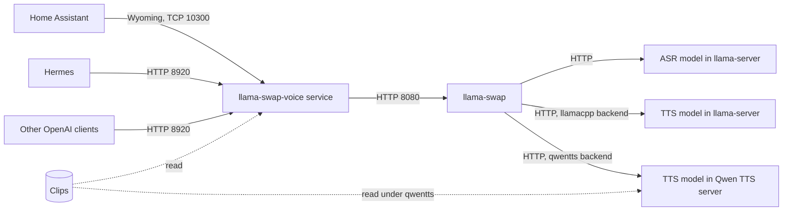

# llama-swap-voice

llama-swap-voice adds speech to the
[llama-swap](https://github.com/mostlygeek/llama-swap) you already run.
llama-swap is a proxy that starts and stops local model servers on demand.
This service puts OpenAI's audio API in front of it. Any client that can talk
to OpenAI can then listen and speak through your own machine.

Two Qwen3 models do the work. One turns speech into text (automatic speech
recognition, ASR). The other turns text into speech (TTS) in a voice that it
copies from a short recording you supply. This is voice cloning.

You get:

- one HTTP service with `/v1/audio/speech` and `/v1/audio/transcriptions`;
- an optional Wyoming listener in the same service, so Home Assistant
  connects directly;
- a NixOS module that runs the service, adds both models to llama-swap and
  connects the two;
- replies that stream as MP3, Opus, WAV or PCM, at any speed from 0.25 to 4;
- a choice of two TTS backends: llama.cpp on any hardware, or a Python server
  on an NVIDIA GPU that also keeps the speaker's accent.

## Quick start

You need a NixOS machine with flakes enabled. These steps run the models on
the CPU. [Options](#options) shows how to use a GPU.

1. Put this `flake.nix` beside your `configuration.nix`. If you already have
   a flake, add the input, the module and the settings to it. `voicebox` is
   an example name for the system.

   ```nix
   {
     inputs = {
       nixpkgs.url = "github:NixOS/nixpkgs/nixos-unstable";
       llama-swap-voice.url = "github:mniehe/llama-swap-voice";
     };

     outputs = {
       nixpkgs,
       llama-swap-voice,
       ...
     }: {
       nixosConfigurations.voicebox = nixpkgs.lib.nixosSystem {
         system = "x86_64-linux";
         modules = [
           ./configuration.nix
           llama-swap-voice.nixosModules.default
           {
             services.llama-swap.enable = true;

             services.llama-swap-voice = {
               enable = true;
               defaultVoice = "sample";
               voices.sample.clip = "/srv/voices/sample.wav";
             };
           }
         ];
       };
     };
   }
   ```

2. Download a recording to clone. This one is the sample from Qwen's
   documentation.

   ```sh
   sudo mkdir -p /srv/voices
   sudo curl -L -o /srv/voices/sample.wav \
     https://qianwen-res.oss-cn-beijing.aliyuncs.com/Qwen3-TTS-Repo/clone.wav
   ```

3. Build and activate the system. The first build downloads four model
   files, about 4.8 GB. llama-swap loads both models when it starts.

   ```sh
   sudo nixos-rebuild switch --flake .#voicebox
   ```

4. Ask the service to speak.

   ```sh
   curl -s localhost:8920/v1/audio/speech \
     -H 'Content-Type: application/json' \
     -d '{"input": "The kitchen lights are off.", "response_format": "mp3"}' \
     -o hello.mp3
   ```

   Play `hello.mp3`. You hear the sentence in the sample voice.

5. Send the recording back to be transcribed.

   ```sh
   curl -s localhost:8920/v1/audio/transcriptions -F file=@hello.mp3
   # {"text":"The kitchen lights are off."}
   ```

From here, [use your own voice](#voices), [move the models to a
GPU](#options) or [connect Home Assistant](#connecting-clients).

## How it works

Clients talk only to the service. The service talks only to llama-swap, and
llama-swap runs one server process for each model.



The service has two entrypoints. Clients use OpenAI's audio API on port
8920. Home Assistant speaks its own voice protocol, Wyoming, and connects to
port 10300 when `wyoming.enable` is on. Both entrypoints share one pipeline
and one set of limits. The ports in the diagram are the defaults, and
llama-swap gives each model server its own port. Only one of the two TTS
servers runs: the `tts.backend` option selects it. `llama-server` is the
HTTP server from llama.cpp, and the Qwen TTS server is a Python program.

**A speech request**

1. A client posts text to `/v1/audio/speech` and can name a voice.
2. The service checks the text and the voice. It then waits its turn, because
   it sends one speech request to the TTS model at a time.
3. The service posts the request to llama-swap. Under the `llamacpp` backend
   it attaches the clip of the voice. Under the `qwentts` backend it sends
   only the name of the voice.
4. llama-swap starts the TTS model if it is not running, then passes the
   request on.
5. The model returns audio as it generates it. The service changes the speed
   if you asked for that, encodes the audio and sends it on immediately.
   Playback can start before the sentence is complete.

**A transcription**

1. A client uploads an audio file to `/v1/audio/transcriptions`.
2. The service decodes the upload to 16 kHz mono WAV, the format the ASR
   model expects.
3. The service posts the WAV to llama-swap, which passes it to the ASR model.
4. The service removes the model's language marker from the transcript and
   returns the text.

The service decodes and encodes all audio itself. It runs no external
program such as ffmpeg.

## Voices

A voice is a name plus a clip: a short recording of one speaker. The TTS
model copies the speaker from the clip each time it speaks.

### Declare a voice

Give each voice a name and the path of its clip:

```nix
services.llama-swap-voice = {
  defaultVoice = "narrator";
  voices.narrator = {
    clip = "/srv/voices/narrator.wav";
    transcript = "The exact words spoken in the clip.";
  };
};
```

A request selects a voice by name. A request that names no voice gets
`defaultVoice`.

The clip stays where it is and never enters the Nix store. Four rules
apply:

- Keep clips outside `/home`. Neither the service nor llama-swap can read it.
- A clip is a `.wav` or `.mp3` file of at most 10 MiB.
- Restart the service after you add a voice.
- Use only recordings that you have the right to clone.

[The voices directory](docs/options.md#the-voices-directory) explains
aliases, clips that you add by hand and how to remove a voice.

### Choose a TTS backend

The `tts.backend` option selects the server that speaks.

| | `llamacpp` (default) | `qwentts` |
|---|---|---|
| Server | `llama-server` from llama.cpp | The Qwen TTS server, which runs [faster-qwen3-tts](https://pypi.org/project/faster-qwen3-tts/) |
| How it clones | From a speaker embedding of the clip only | In context, from the clip plus its exact transcript |
| Result | The voice, without its accent | The voice and its accent |
| Hardware | A CPU, or a GPU that `llamaCpp.backend` selects | An NVIDIA GPU on x86_64 Linux |
| A voice needs | A `.wav` or `.mp3` clip | A `.wav` clip that the group `llama-swap-voice` can read, and a `transcript` |
| Extra download | None | The CUDA Python environment, several GB, and the weights, about 4.5 GB |

A speaker embedding is a numeric summary of how a voice sounds. Keep
`llamacpp` on a CPU or a non-NVIDIA GPU, or when the accent does not
matter. Select `qwentts` on an NVIDIA GPU to keep the accent:

```nix
services.llama-swap-voice.tts.backend = "qwentts";
```

Under `qwentts`, three more things apply:

- A voice with a `null` transcript falls back to embedding-only cloning. That
  keeps the voice but loses its accent.
- The Qwen TTS server reads each clip itself, as llama-swap's user. Make each
  clip readable by the service's group, for example mode `0640` and group
  `llama-swap-voice`. An unreadable clip stops the server at startup, and the
  error appears in llama-swap's upstream log.
- Transcripts and style instructions go into the Nix store, which every user
  can read. Do not put secrets in them.

Nix builds the CUDA environment and the weights only for a system that
selects `qwentts`. `nix flake check` builds neither.

### Prepare a clip

Neither TTS server changes a clip, so prepare each clip once. You need
ffmpeg for this step only.

1. Cut about 30 seconds of clean speech. Start and end on a sentence
   boundary.
2. Measure the loudness of the source.

   ```sh
   ffmpeg -hide_banner -nostats -i source.wav \
     -af loudnorm=I=-22:TP=-1.5:LRA=11:print_format=json -f null -
   ```

3. Normalise the clip with the measured values. Copy `input_i`, `input_tp`,
   `input_lra`, `input_thresh` and `target_offset` from the output of step 2
   into shell variables of the same names. The result is mono, 24 kHz,
   16-bit WAV at -22 LUFS with a true peak of -1.5 dBTP.

   ```sh
   ffmpeg -hide_banner -i source.wav \
     -af loudnorm=I=-22:TP=-1.5:LRA=11:measured_I=$input_i:measured_TP=$input_tp:measured_LRA=$input_lra:measured_thresh=$input_thresh:offset=$target_offset:linear=true:print_format=summary \
     -ac 1 -ar 24000 -sample_fmt s16 narrator.wav
   ```

4. Under `qwentts`, write the exact words of the clip into the `transcript`
   of the voice. The server cannot tell a wrong transcript from a right one,
   and a wrong one ruins the voice.

`loudnorm` can change the character of a voice without a warning.
[Check that a clip has one constant gain](docs/options.md#check-that-a-clip-has-one-constant-gain)
shows how to test for that.

## Options

All options are under `services.llama-swap-voice`.
[Module options](docs/options.md) lists every option with its type, default
and effect.

### How the options fit together

Enable the module, declare one voice and name it as `defaultVoice`. The
module then does the rest:

1. It runs the service on `127.0.0.1:8920` as a sandboxed systemd unit.
2. It downloads the ASR model and the TTS model, each pinned by hash.
3. It adds one entry for each model to `services.llama-swap.settings`, beside
   your own models. An entry is llama-swap's description of one model: its
   name and the command that serves it.
4. It puts both entries in a llama-swap group that keeps them loaded. Set
   `llamaSwap.group.sharing = "takeTurns"` when one GPU cannot also hold a
   chat model.
5. It points the service at that llama-swap.

Besides the voices, most people change only a few options. This example
shows them:

```nix
services.llama-swap-voice = {
  enable = true;

  # Run llama.cpp on an NVIDIA GPU. "vulkan" and "rocm" also work.
  llamaCpp.backend = "cuda";

  # Keep the speaker's accent. This needs an NVIDIA GPU.
  tts.backend = "qwentts";

  # Accept clients from the local network. The service asks for no API key.
  host = "0.0.0.0";
  ipAddressAllow = ["192.168.1.0/24"];
};
```

These are the options in the example, and two related ones:

| Option | Default | Effect |
|---|---|---|
| `tts.backend` | `"llamacpp"` | Selects the TTS server: `"llamacpp"` or `"qwentts"`. |
| `llamaCpp.backend` | `"cpu"` | Selects the hardware for llama.cpp: `"cpu"`, `"cuda"`, `"vulkan"` or `"rocm"`. |
| `host` | `"127.0.0.1"` | The address the service listens on. |
| `ipAddressAllow` | `[]` | Addresses, besides loopback, that the service can exchange packets with. |
| `upstreamURL` | your `services.llama-swap` | The base URL of llama-swap. Set it when llama-swap runs on another machine. |
| `llamaSwap.group.sharing` | `"pinned"` | Selects whether the voice models stay loaded or take turns with your other models. |

Two settings stop evaluation most often. `services.llama-swap.enable` must
be on. And `services.llama-swap.settings.apiKeys` must be unset, because the
service cannot send an API key.

## Connecting clients

Any client of OpenAI's audio API works. Give it the base URL
`http://<host>:8920/v1`, the model names `qwen3-asr` and `qwen3-tts`, and the
name of a voice. The service needs no API key and ignores one if a client
sends it.

### Hermes

Hermes, an AI agent with a voice mode, speaks the OpenAI audio API. Put
this in `~/.hermes/config.yaml`:

```yaml
stt:
  provider: openai
  openai:
    base_url: http://localhost:8920/v1
    api_key: not-needed
    model: qwen3-asr
tts:
  provider: openai
  openai:
    base_url: http://localhost:8920/v1
    api_key: not-needed
    model: qwen3-tts
    voice: sample
```

### Home Assistant

Home Assistant speaks the Wyoming protocol. The service serves it on a
second port, so Home Assistant connects to the service directly.

1. Set `wyoming.enable = true`.
2. Set `wyoming.host` to an address of this machine that Home Assistant can
   reach.
3. Add Home Assistant's address or network to `ipAddressAllow`.
4. Open the port in the firewall: set `wyoming.openFirewall = true`, or
   open port 10300 for one interface.
5. In Home Assistant, add the Wyoming Protocol integration with that host
   and port 10300. It finds speech to text and text to speech.
6. In the voice assistant settings, select a voice, or leave it unset for
   `defaultVoice`.

This example is for Home Assistant in Docker on the default bridge network.
The container reaches the host at `172.17.0.1`.

```nix
services.llama-swap-voice = {
  wyoming = {
    enable = true;
    host = "172.17.0.1";
    # Speak a little faster. 1.0 leaves the speech as the model made it.
    speed = 1.1;
  };
  ipAddressAllow = ["172.17.0.0/16"];
};

# Docker creates 172.17.0.1 when it starts, so bind after it.
systemd.services.llama-swap-voice.after = ["docker.service"];

# Open the port on the bridge only.
networking.firewall.interfaces.docker0.allowedTCPPorts = [10300];
```

`ipAddressAllow = ["172.17.0.0/16"]` admits every container on the default
bridge, not only Home Assistant. To admit Home Assistant alone, allow its
container's own address, or put it on a user-defined Docker network and
allow that network.

`wyoming.speed` sets the speed of every reply over Wyoming. The voice keeps
its pitch.

Some details of how Home Assistant uses the service:

- Home Assistant asks for the service's description every 30 seconds and
  replaces its speech service when the description changes. A change to
  `wyoming.streaming` therefore reaches it within about 30 seconds. To pick
  up a new model name at once, reload the Wyoming integration.
- Home Assistant sorts the voices by description or name. The default voice
  is the one marked `(default)`.
- With `wyoming.streaming = "sentences"`, the default, Home Assistant sends
  the reply of a language model as it is written, and the service speaks
  each sentence as soon as it is complete.
- Each sentence takes one speech slot. Eight sentences in progress at once
  fill the slots, and the next one fails with `busy`. Raise
  `request.maxConcurrentTTS` if many satellites speak at the same time.
- `ipAddressAllow` applies to the whole unit. An address that you allow for
  Wyoming can also reach the HTTP port if `host` is an address that it can
  reach. With `host` on its default, `127.0.0.1`, it cannot.

[Wyoming](docs/options.md#wyoming) lists every option and what evaluation
refuses.

## Reference

| Page | Contents |
|---|---|
| [Module options](docs/options.md) | Every option, the Wyoming options included; what the module refuses and what it adds to llama-swap; when the models unload; concurrency; the sandbox and the GPU; the environment variables |
| [The HTTP API](docs/api.md) | Endpoints, audio formats, errors and status codes, limits and shutdown; the Wyoming listener's events, limits and errors |
| [The Qwen TTS server](docs/qwen-tts-server.md) | The Python server of the `qwentts` backend: startup and exit, behaviour under llama-swap, the configuration file, endpoints and errors |

## Running without Nix

The service is one Go binary. To build it you need cgo, a C compiler,
pkg-config and libopus.

1. Install the service.

   ```sh
   go install github.com/mniehe/llama-swap-voice/cmd/llama-swap-voice@latest
   ```

2. Add the two models to your llama-swap configuration. Copy
   [the same entries in YAML](docs/options.md#the-same-entries-in-yaml).

3. Put a clip named `sample.wav` in `~/voices` and start the service.

   ```sh
   LLAMA_SWAP_VOICE_VOICES_DIR=~/voices \
   LLAMA_SWAP_VOICE_VOICES_DEFAULT=sample \
   LLAMA_SWAP_VOICE_UPSTREAM_URL=http://127.0.0.1:8080 \
   llama-swap-voice
   ```

[Environment variables](docs/options.md#environment-variables) lists every
setting. Only the flake builds the Qwen TTS server.

## Development

The flake's development shell supplies the toolchain and the test tools.

```sh
nix develop                    # an interactive shell
nix develop -c go test ./...   # the Go tests; no GPU, model or llama-swap needed
nix flake check                # every check that gates a push, VM tests included
nix build -L .#checks.x86_64-linux.qwen-tts-server-tests   # the Python tests; no GPU or torch needed
```

The Go tests decode the service's own output with opus-tools and ffmpeg.
They skip those checks when the tools are missing, so run them inside the
development shell. `AGENTS.md` lists every verification step.

## Licence

The repository is MIT, and so is the Qwen TTS server's own code.

A binary of the service also includes
[shine-mp3](https://github.com/braheezy/shine-mp3), which is LGPL-2.0, and
links [libopus](https://opus-codec.org), which is BSD-3-Clause.

The Qwen3 models are Apache-2.0. The Qwen team publishes them, and
[ggml-org](https://huggingface.co/ggml-org) converts them to GGUF. The
weights that the Qwen TTS server loads, Qwen/Qwen3-TTS-12Hz-1.7B-Base at the
pinned revision, are Apache-2.0 by their model card.

<details>
<summary>Licences in the Qwen TTS server's Python environment</summary>

Each resolved package declares these licences in its metadata:

- **NVIDIA proprietary** (`LicenseRef-NVIDIA-Proprietary`; cusparselt says
  "NVIDIA Proprietary Software"): the CUDA runtime libraries nvidia-cublas,
  -cuda-cccl, -cuda-cupti, -cuda-nvrtc, -cuda-runtime, -cudnn-cu13, -cufft,
  -cufile, -cusolver, -cusparse, -cusparselt-cu13, -nccl-cu13, -nvjitlink,
  -nvshmem-cu13 and -nvtx. The cuda-toolkit metapackage declares no licence
  and installs only its metadata.
- **LGPL-2.1-or-later**: soxr.
- **MPL-2.0**: certifi; tqdm is MPL-2.0 AND MIT.
- **Apache-2.0**: qwen-tts-hf, transformers, accelerate, cuda-bindings,
  cuda-pathfinder, flatbuffers, hf-xet, huggingface-hub, msgpack, requests,
  safetensors and tokenizers; packaging is Apache-2.0 OR BSD-2-Clause and
  regex Apache-2.0 AND CNRI-Python.
- **Compound**: torch is Apache-2.0 AND Apache-2.0 WITH LLVM-exception AND
  BSD-2-Clause AND BSD-3-Clause AND BSL-1.0 AND ISC AND MIT AND Zlib; numpy is
  BSD-3-Clause AND 0BSD AND MIT AND Zlib AND CC0-1.0; llvmlite is BSD-2-Clause
  AND Apache-2.0 WITH LLVM-exception.
- **BSD**: starlette, uvicorn, soundfile, sox, torchaudio, numba, scipy,
  scikit-learn, httpx, httpcore, click, cloudpickle, fsspec, idna, jinja2,
  joblib, lazy-loader, markupsafe, mpmath, networkx, pooch, protobuf, psutil,
  pycparser, pygments, decorator, sympy and threadpoolctl.
- **ISC**: librosa and shellingham.
- **MIT**: faster-qwen3-tts, triton, onnxruntime, annotated-doc, anyio,
  charset-normalizer, einops, filelock, h11, markdown-it-py, mdurl, narwhals,
  platformdirs, pyyaml, rich, setuptools, typer and urllib3; cffi is MIT-0.
- **PSF-2.0**: typing-extensions.

pytest, iniconfig and pluggy (MIT) are used by the tests only. The launcher
also puts the SoX program (GPL-2.0-or-later) on the path, and soundfile loads
libsndfile (LGPL-2.0-or-later), both from nixpkgs.

</details>
