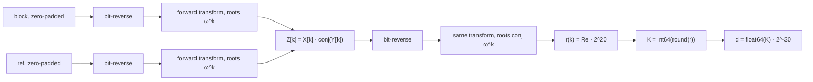

# Why `Correlate` is exact

`Correlate` computes integer-valued cross-correlations with a binary64
FFT and rounds each result to the nearest integer. This page proves that
the floating-point error is always below 0.0177 of an integer step for
inputs inside the contract, and below 0.00826 for the lengths
`internal/audio` uses. Rounding to the nearest step is therefore exact.
The proof is a priori: it holds for every input inside the contract, so
the code carries no runtime check.

The proof covers only the code as it stands. The last section lists the
changes that void it.

## The theorem

**Contract.** Each element of `block` and `ref` is an integer multiple of
2^-15 with magnitude at most 1. Also, `len(ref) <= len(block) <= N = 1024`.
For each lag k in [0, len(block) − len(ref)], the true dot product is

    d(k) = Σ_{i < len(ref)} block[k+i] · ref[i] = K(k) · 2^-30

where K(k) is an integer, because each product is a multiple of 2^-30.
Since |d(k)| ≤ len(ref) ≤ 2^10, |K(k)| ≤ 2^40.

**The empty reference.** If `len(ref) = 0`, every d(k) is the empty sum,
0, and there are len(block) + 1 lags, up to N + 1, one more than the
transform has outputs. `Correlate` then writes +0 to each lag and runs no
transform, so no FFT output is used and the theorem below is not needed.
The theorem covers `len(ref) >= 1`, where there are at most N lags.

**Theorem.** Let `len(ref) >= 1`, and let r(k) be the computed value
`scaled[k] · 2^20` that `Correlate` rounds. Then

    |r(k) − K(k)| ≤ 2^30 · ‖x‖·‖y‖ · [(1+u)^30 (1+3u)^31 (1+u/√2)^30 − 1] + 2^-1000

Here u = 2^-53, and ‖x‖ and ‖y‖ are the Euclidean norms of `block` and
`ref` in sample units.

* For the general contract, ‖x‖·‖y‖ ≤ √(len(block)·len(ref)) ≤ 1024. The
  bound is **0.0176041508…** integer units, 28× below 0.5.
* For `internal/audio`, len(block) ≤ 960 and len(ref) = 240, so
  ‖x‖·‖y‖ ≤ √(960·240) = 480. The bound is **0.0082519456…** integer
  units, 60× below 0.5.

**Corollary.** Since |r(k) − K(k)| < 1/2, `math.Round(r(k))` returns K(k),
with no tie possible, except that a zero K may come back as −0 when r(k)
is slightly negative. The conversion to `int64` is exact, because K is an
integer with |K| ≤ 2^40 < 2^63, and it maps −0 to 0. `float64` of that
integer is exact too, since 2^40 < 2^53, so `float64(K) * 0x1p-30` is
exactly d(k), and a zero K gives +0, as the direct sum does.

## Sources

* C. Percival, "Rapid multiplication modulo the sum and difference of
  highly composite numbers", *Math. Comp.* 72 (2003) 387–395, Theorem 5.1,
  <https://www.daemonology.net/papers/fft.pdf>. For a radix-2 FFT
  convolution of length N = 2^n with roots within β of exact:
  |z′ − z|∞ < |x|·|y|·((1+ε)^{3n} (1+ε√5)^{3n+1} (1+β)^{3n} − 1).
* R. Brent and P. Zimmermann, *Modern Computer Arithmetic*, v0.5.9,
  Theorem 3.6, p. 99, <https://members.loria.fr/PZimmermann/mca/mca-cup-0.5.9.pdf>.
  This is the same theorem, restated.
* R. Brent, C. Percival and P. Zimmermann, "Error bounds on complex
  floating-point multiplication", *Math. Comp.* 76 (2007), p. 1469,
  <https://maths-people.anu.edu.au/~brent/pd/rpb221.pdf>. It says the 2003
  proof of the √5 constant "was incorrect, although the result claimed was
  true", and it assumes no underflow.

This page does not use the √5 constant. Lemma 2 proves a 3u bound for one
complex multiply, which also covers subnormal results. Otherwise the proof
follows Percival's structure, with n = 10. With the √5 constant, the
WSOLA figure would be 0.0068968569…; the 3u form used here gives
0.0082519456….

## The operation graph



1. **Load.** `block` and `ref` go into separate length-1024 complex
   arrays. The imaginary parts are zero, the elements beyond the input are
   zero, and the order is bit-reversed. These steps are exact.
2. **Forward transform**, run twice, once per array. This is the textbook
   radix-2 decimation-in-time FFT: n = 10 stages. Stage s (span 2^{s−1})
   applies 512 butterflies to disjoint pairs:

       t      = ŵ ⊗ b                      (complex multiply below)
       top    = a ⊕ t,   bottom = a ⊖ t    (component-wise adds)

   ŵ is `roots[j·stride]`, the stored value of ω^{j·stride} with
   ω = exp(−2πi/1024). The complex multiply of ŵ = (c, s) by b = (x, y) is

       re = fl( fl(c·x) − fl(s·y) )
       im = fl( fl(c·y) + fl(s·x) )

   The `float64(...)` conversions in `correlate`'s butterfly loop make
   each product round before its addition (see "FMA").
3. **Product.** For each k, Z = X·conj(Y) is computed as
   re = fl(fl(a·c) + fl(b·d)), im = fl(fl(b·c) − fl(a·d)), with
   X = (a, b) and Y = (c, d). Conjugation is an exact sign change.
4. **Reorder.** The spectrum is permuted into bit-reversed order, which is
   exact.
5. **Inverse transform.** This is step 2's code, with `conjugates`
   (each stored root with its imaginary part negated, which is exact) and
   without a 1/N factor.
6. **Scale and round.** r(k) = Re(ĥ[k]) · 2^20. A power-of-two scale is
   exact. Then `math.Round` rounds r to an integral float64, and
   `int64(...)` converts it to an integer K, which turns a rounded −0 into
   0. Finally d = `float64(K)` · 2^-30, which is also exact. The tests
   meet the −0 case: in `TestCorrelate_Cancellation_IsExactZero`, a
   constant block of −32768 against a reference of 120 × 32767 then
   120 × −32767 gives r = −1.304989997088438e-06 at lag 1, which
   `math.Round` takes to −0, and `Correlate` returns +0.

**The exact counterpart.** With exact roots ω^k and exact arithmetic,
step 2 maps x to its DFT, X[m] = Σ_n x[n] ω^{nm}. The unnormalised
inverse with conjugate roots maps Z to G(Z)[k] = Σ_m Z[m] ω^{−km}. So

    G(X·conj Y)[k] = Σ_{n,i} x[n] y[i] Σ_m ω^{(n−i−k)m} = N · Σ_i x[(k+i) mod N] y[i].

Correlation therefore needs no reversal of y: for real y, conj(Y) is the
spectrum of y circularly reversed, which is an exact permutation. For
k ≤ len(block) − len(ref) and i < len(ref), k + i ≤ len(block) − 1 < N,
so no index wraps, and G(Z)[k] = N · d(k). Then 2^20 · N · d(k) = 2^30 ·
d(k) = K(k): the exact pipeline yields K exactly.

## Arithmetic model

IEEE 754 binary64, round to nearest even, u = 2^-53, η = 2^-1074 (the
smallest subnormal).

* **Product:** |fl(a·b) − a·b| ≤ u|a·b| + η.
* **Sum or difference of two floats:** |fl(a ± b) − (a ± b)| ≤ u|a ± b|.
  If the exact sum is subnormal it is representable, so no η term arises.
* **Complex add, component-wise:** |fl(z) − z| ≤ u|z| in modulus, because
  each component errs by at most u times itself.
* **Finite execution.** The rounding model above, and so Lemmas 2 to 6,
  hold only while every intermediate is finite, with no overflow. The
  following coarse bound shows that every execution inside the contract
  is finite, without using the lemmas themselves. Rounding is monotone,
  so a value of modulus at most B rounds to at most fl(B) ≤ B(1+u).
  Every stored root has components of magnitude at most 1.
  * *Butterfly.* If every input component has magnitude at most M ≥ 1,
    each product fl(c·x) is at most M(1+u), each component of t̂ is at
    most 2M(1+u)², and each output component is at most
    (M + 2M(1+u)²)(1+u), which is below 4M.
  * *Pointwise multiply.* If every component of X̂ and Ŷ is below M ≥ 1,
    each product is at most M²(1+u), and each output component is at
    most 2M²(1+u)², below 4M².

  The inputs have components at most 1. Ten forward stages give
  components below 4^10 = 2^20; the multiply gives below 4 · 2^40 = 2^42;
  ten inverse stages give below 2^42 · 4^10 = 2^62; the exact 2^20
  upshift gives below 2^82. All of these are far below binary64's
  largest finite value, about 2^1024, so no step overflows, and no NaN
  arises. The `int64` conversion needs the sharper range that the
  theorem then gives: |r| < |K| + 1/2 ≤ 2^40 + 1/2.

Write q = (1+u)(1+3u)(1+β), with β = u/√2 the root error (see
"Twiddles"), and p = 1+3u. Norms ‖·‖ are Euclidean, ‖·‖₁ is the sum of
moduli, and |·| is the complex modulus.

## Lemma 1 (root accuracy)

Each stored root satisfies |ŵ − ω^k| ≤ β = u/√2. So |ŵ| ≤ 1+β. The
conjugate table has the same error, since conjugation is exact.

*Proof.* See "Twiddles" below.

## Lemma 2 (complex multiply)

For floats w = (c, s) and b = (x, y), the computed product satisfies
|fl(w⊗b) − w·b| ≤ 3u|w||b| + 3η.

*Proof.* Write e₁ = fl(cx) − cx and e₂ = fl(sy) − sy, so
|e₁| + |e₂| ≤ u(|cx| + |sy|) + 2η. The real part errs by at most

    (1+u)(|e₁| + |e₂|) + u|cx − sy| ≤ u(2+u)(|cx| + |sy|) + 2(1+u)η.

By symmetry, the imaginary part errs by at most
u(2+u)(|cy| + |sx|) + 2(1+u)η. Minkowski's inequality bounds the modulus
of the error by

    u(2+u) · √((|cx|+|sy|)² + (|cy|+|sx|)²) + 2√2(1+u)η.

Expand the root: it is (c²+s²)(x²+y²) + 4|cs||xy|. Since 2|cs| ≤ c²+s²
and 2|xy| ≤ x²+y², it is at most 2|w|²|b|². So the error is at most
√2·u(2+u)|w||b| + 2√2(1+u)η ≤ 3u|w||b| + 3η, since √2(2+u) < 3 and
2√2(1+u) < 3. ∎

The same proof covers step 3's X·conj(Y), because the conjugate changes
only signs.

**Multiply by a stored root.** For an exact root ω and a float b, write
t = ω·b. Then |fl(ŵ⊗b) − t| ≤ 3u|ŵ||b| + 3η + |ŵ − ω||b|. This is at most
μ|b| + 3η, where μ = 3u(1+β) + β = (1+3u)(1+β) − 1.

## Lemma 3 (one butterfly)

Let â and b̂ be floats, and let t = ω·b̂. The exact butterfly on them
outputs (â+t, â−t), whose pair norm is
√(|â+t|² + |â−t|²) = √2 · √(|â|² + |b̂|²). The computed pair
(fl(â⊕t̂), fl(â⊖t̂)) differs from it by at most

    (q − 1) · √2 · √(|â|² + |b̂|²) + 3√2(1+u)η.

*Proof.* Let t̂ = fl(ŵ⊗b̂). For the top output,
|fl(â⊕t̂) − (â+t)| ≤ u|â+t̂| + |t̂−t| ≤ u|â+t| + (1+u)|t̂−t|. The bottom
output is bounded the same way. By Minkowski's inequality over the pair,
the error is at most u·√(|â+t|² + |â−t|²) + √2(1+u)|t̂−t|. Next,
√2(1+u)|t̂−t| ≤ (1+u)μ·√2|b̂| + 3√2(1+u)η, and √2|b̂| is at most the pair
norm. Finally, u + (1+u)μ = (1+u)(1+3u)(1+β) − 1 = q − 1. ∎

## Lemma 4 (forward transform, Euclidean norm)

For a float input vector v of length N, the computed transform F̂(v)
satisfies

    ‖F̂(v) − F(v)‖ ≤ (q^10 − 1)‖F(v)‖ + 7260η,   with ‖F(v)‖ = 32‖v‖.

*Proof.* Let v_s be the exact result after stage s, and v̂_s the computed
one. Each exact stage M_s is √2 times a unitary map, because the
butterfly identity gives |a+ωb|² + |a−ωb|² = 2(|a|² + |b|²). So
‖v_s‖ = 2^{s/2}‖v‖. Sum Lemma 3 over the 512 disjoint pairs, using
Minkowski's inequality on the η term (√512 · 3√2 = 96). The rounding in
stage s is then at most (q−1)√2‖v̂_{s−1}‖ + 96(1+u)η. Hence, with
e_s = ‖v̂_s − v_s‖,

    e_s ≤ √2·e_{s−1} + (q−1)√2(2^{(s−1)/2}‖v‖ + e_{s−1}) + 97η
        = √2q·e_{s−1} + (q−1)2^{s/2}‖v‖ + 97η.

By induction, e_s ≤ (q^s − 1)2^{s/2}‖v‖ + 97η·Σ_{j<s}(√2q)^j. To check
the step: √2q(q^{s−1} − 1)2^{(s−1)/2} + (q−1)2^{s/2} = (q^s − 1)2^{s/2}.
At s = 10, Σ_{j<10}(√2q)^j = 74.84…, so the η term is below 7260η. ∎

Bit reversal and zero padding are exact, and the input is on the float
lattice, so v̂_0 = v_0.

## Lemma 5 (inverse transform, one output)

For a float input vector v, each output m of the computed inverse Ĝ(v)
satisfies

    |Ĝ(v)[m] − G(v)[m]| ≤ (q^10 − 1)‖v‖₁ + 3070η.

*Proof.* After s stages, each exact element v_s[i] is a sum, with
unit-modulus coefficients, of v over a set S_i of 2^s indices. A
butterfly's two inputs have disjoint sets, and both outputs have their
union. Let A_s[i] = Σ_{j∈S_i}|v[j]|. Then |v_s[i]| ≤ A_s[i], and each
butterfly output has A = A_a + A_b.

Claim: |v̂_s[i] − v_s[i]| ≤ (q^s − 1)A_s[i] + H_s, with H_0 = 0 and
H_s = 2qH_{s−1} + 3(1+u)η. Take a butterfly with input errors e_a and
e_b. From the multiply-by-root bound,
|t̂ − ωb| ≤ μ|b| + (1+μ)e_b + 3η. The top output then errs by at most

    (1+u)(e_a + μ|b| + (1+μ)e_b + 3η) + u(|a| + |b|)
      ≤ q(e_a + e_b) + (q − 1)(A_a + A_b) + 3(1+u)η.

This uses 1+u ≤ q, (1+u)(1+μ) = q, (1+u)μ + u = q − 1 and u ≤ q − 1.
Substituting the claim for e_a and e_b gives
q(q^{s−1} − 1)(A_a + A_b) + (q−1)(A_a + A_b) = (q^s − 1)A_s. The bottom
output is bounded the same way. At s = 10, A_10[m] = ‖v‖₁ and
H_10 = 3(1+u)η · Σ_{j<10}(2q)^j = 3069.0000000000131…η, because q > 1
makes each term slightly above 3·2^j. So H_10 < 3070η. ∎

## Lemma 6 (pointwise product, ℓ1 norm)

    ‖Ẑ − Z‖₁ ≤ (p·q^20 − 1)‖X‖·‖Y‖ + 2^27η.

*Proof.* Per element, Ẑ_k − Z_k = [Ẑ_k − X̂_k·conj Ŷ_k] + (X̂_k − X_k)·conj Ŷ_k + X_k·conj(Ŷ_k − Y_k).
Apply Lemma 2 to the first term, and Cauchy–Schwarz to the sums of the
others:

    ‖Ẑ − Z‖₁ ≤ 3u‖X̂‖‖Ŷ‖ + 3Nη + ‖X̂ − X‖‖Ŷ‖ + ‖X‖‖Ŷ − Y‖.

Lemma 4 gives ‖X̂ − X‖ ≤ (q^10 − 1)‖X‖ + 7260η, and so
‖X̂‖ ≤ q^10‖X‖ + 7260η, and likewise for Y. The non-η terms sum to
‖X‖‖Y‖·[3u·q^20 + (q^10 − 1)q^10 + (q^10 − 1)] = (p·q^20 − 1)‖X‖‖Y‖. The
η terms are bounded using ‖X‖, ‖Y‖ ≤ 1024, counting η² as η. That
over-count gives 6.76·10^7·η < 2^27η. ∎

## Combining

Apply Lemma 5 to the computed spectrum Ẑ, and use |G(w)[m]| ≤ ‖w‖₁,
because every coefficient of G has unit modulus:

    |Ĝ(Ẑ)[m] − G(Z)[m]| ≤ |Ĝ(Ẑ)[m] − G(Ẑ)[m]| + ‖Ẑ − Z‖₁
                        ≤ (q^10 − 1)(‖Z‖₁ + ‖Ẑ − Z‖₁) + ‖Ẑ − Z‖₁ + 3070η
                        ≤ (q^10 − 1)‖X‖‖Y‖ + q^10(p·q^20 − 1)‖X‖‖Y‖ + 2^28η
                        = (p·q^30 − 1)‖X‖‖Y‖ + 2^28η.

The η terms are q^10 · 2^27η from Lemma 6 and 3070η from Lemma 5, which
sum to 134,220,798.0000000007…η < 2^28η.

This uses ‖Z‖₁ = Σ|X_k||Y_k| ≤ ‖X‖‖Y‖. By Parseval, ‖X‖‖Y‖ = N·‖x‖‖y‖,
and G(Z)[m] = N·d(m). The real part errs no more than the complex value.
Multiplying by 2^20 = 2^30/N is exact and turns d into K:

    |r(m) − K(m)| ≤ 2^30·‖x‖‖y‖·(p·q^30 − 1) + 2^48η.

Here p·q^30 = (1+u)^30(1+3u)^31(1+u/√2)^30, and 2^48η = 2^-1026 < 2^-1000.

### The arithmetic

Computed with Python `decimal` at 90 significant digits:

| quantity | value |
|---|---|
| q − 1 | 5.2259383278425144…·10^-16 |
| p·q^30 − 1 | 1.6010881890915214…·10^-14 (144.2132 u) |
| WSOLA: 480 · 2^30 · (p·q^30 − 1) | 0.0082519456921919381… |
| general: 1024 · 2^30 · (p·q^30 − 1) | 0.0176041508100094680… |
| Percival's √5 form, WSOLA, for comparison | 0.0068968569224218770… |

The η terms add below 2^-1000 and change no digit shown. The tests'
worst observed |r − K| is 9.2·10^-5 integer units, about 1/90 of the WSOLA
bound.

## Twiddles

The bound needs |ŵ − ω^k| ≤ β = u/√2. Go's `math.Sincos` has no
documented error bound, and was measured at about 3.47 ulp at k = 341 on
Go 1.27.3. So the roots come from a checked-in table, `twiddles.go`, in
which every component is correctly rounded.

**From correct rounding to β.** A correctly rounded component v̂ of v
errs by at most half an ulp: |v̂ − v| ≤ 2^{e−53}, where 2^e ≤ |v| < 2^{e+1}.
If |cos| or |sin| equals 1, the other component is 0, and both are stored
exactly. Otherwise both magnitudes are below 1, so 2^e ≤ 1/2 for each, and

    |ŵ − ω|² ≤ u²(2^{2e_c} + 2^{2e_s}) ≤ u²(1/4 + 1/4) = u²/2.

The test also computes this error directly. The largest is 0.640744 u, at
most u/√2 = 0.707107 u.

**The generator** (`gentwiddle/main.go`, run by `go generate`) is not a
high-precision estimate, because an estimate alone certifies nothing: the
exact value could lie on the other side of a rounding midpoint. It
computes an interval known to contain each exact value:

* `math/big` floats at 320 bits, with directed rounding: lower ends round
  down and upper ends round up.
* π from Machin's formula, 16·arctan(1/5) − 4·arctan(1/239). Each
  arctangent series alternates with shrinking terms, so the error after
  any term is at most the next term, which is added to the interval.
* sin and cos of πr/512 for r in [0, 128] from their Taylor series. The
  Lagrange remainder after the degree-(n−1) term is at most x^n/n!, which
  is added to the interval.
* The other angles follow by exact identities: π/2 − φ swaps sin and cos,
  π/2 + φ and π − φ change signs. So cos(π/2) = sin(0) = 0 exactly.

A component is written only when both interval ends round to the same
binary64 value. Rounding is monotone, so every value in the interval, the
exact one included, rounds to that value. Otherwise the generator exits
with an error.

**The certificate** (`TestRoots_AreCorrectlyRounded`) checks every stored
component by a different route. It uses Gauss's formula for π,
48·arctan(1/18) + 32·arctan(1/57) − 20·arctan(1/239), at 512 bits, and
the Taylor series over the whole angle [0, π) with no reduction by
symmetry. The only exception is cos(π/2), which it sets to zero by
identity, because no interval can certify an exact zero. For each
component, the test asserts:

1. both ends of the exact interval round to the stored value;
2. |stored − exact| ≤ half an ulp of the stored value;
3. per root, √(err_re² + err_im²) ≤ u/√2.

Changing one stored root by one ulp fails the test.

## FMA

The Go specification ("Floating-point operators") lets an implementation
fuse x·y + z into one FMA, which rounds once. The lemmas assume that
every product rounds on its own. The same section says that "an explicit
floating-point type conversion rounds to the precision of the target type,
preventing fusion". A temporary variable is not such a barrier. Every
product in `correlate`'s butterfly loop and in `multiplyConjugate` is therefore wrapped in
`float64(...)`, and so is each component before it enters a butterfly's
add or subtract.

The tests run on amd64 v1, which has no FMA instruction, so they cannot
see a lost conversion. The `fft-no-fma` check in `nix/checks.nix`, which
`nix flake check` runs, compiles this package for amd64 v3 and for arm64
and fails if either build fails, if the assembly lacks `correlate` or
`multiplyConjugate`, or if it holds any fused multiply-add. To run it
alone:

```bash
nix build -L .#checks.x86_64-linux.fft-no-fma
```

The code also avoids Go's `complex128` multiplication, because the
specification leaves its lowering open.

## Do not change without redoing the proof

* **Radix and graph.** Radix 2, decimation in time, bit-reversed input,
  10 stages, and the same butterfly graph for the forward and inverse
  transforms. Split-radix, radix 4, decimation in frequency, or a fused
  kernel each change the error recursion.
* **No packing.** Two separate forward transforms with zero imaginary
  parts. Packing block + i·ref into one transform, or using an N/2-point
  transform for real input, is not covered by these lemmas or by
  Percival's theorem.
* **Twiddle source.** The certified, correctly rounded table, and exact
  conjugates of it for the inverse. Values from `math.Sincos`,
  `math.Cos`, or recurrences break Lemma 1.
* **FMA barriers.** Every `float64(...)` conversion in `correlate` and
  `multiplyConjugate`, and no `complex128` arithmetic.
* **Rounding and upshift.** One exact multiplication by 2^20, then
  `math.Round`, then multiplication by 2^-30. No division by N: scaling
  down first could create subnormals, and a non-power-of-two scale would
  round.
* **Precision.** binary64 throughout. No float32 stages, and no extended
  precision.
* **N.** N = 1024 fixes n = 10 in every power of q. A different N needs
  new arithmetic and a new twiddle table.
* **Input lattice and range.** Inputs are integer multiples of 2^-15 with
  magnitude at most 1, len(ref) ≤ len(block) ≤ N. The bound grows with
  ‖x‖·‖y‖, and K must be an integer for rounding to recover it.
* **Normalisation.** The inverse is unnormalised. The 1/N factor is folded
  into the 2^20 upshift.
